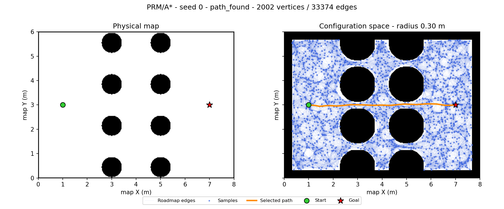
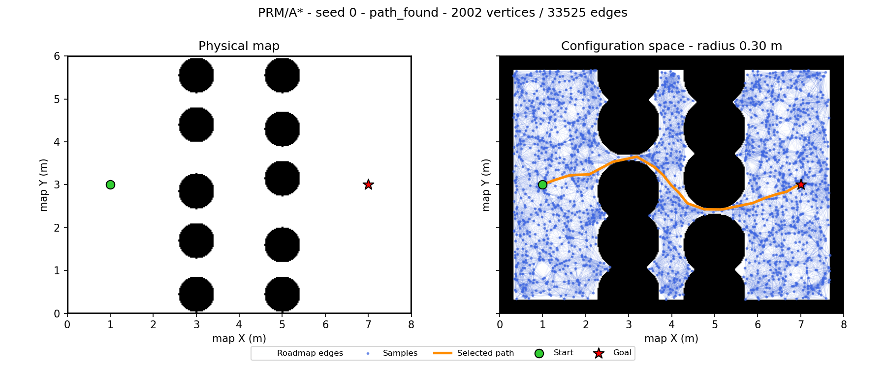
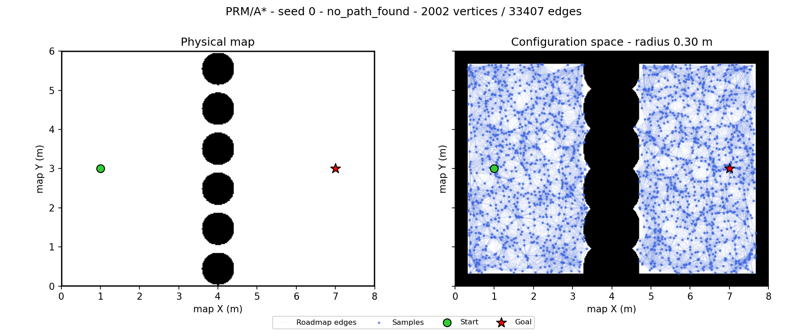

# HW02 report: Configuration Space, PRM and A*

Validation date: 2026-11-20. The implementation tested here is revision
`73c6b41`; final report preparation did not change the algorithms or controller
sequencing. All six required solvable-room executions passed the public observer.
The blocked-room demonstration also passed without requesting movement.

## 1. Scope and implementation

The planner receives the supplied occupancy map, start, and goal from ROS. It
constructs configuration space, samples a PRM, runs our own A* on that graph,
validates the complete result, and optionally executes individual waypoints using
the supplied `RobotClient`. It uses no hardcoded route, obstacle coordinates, or
layout-dependent planning branch.

Planning is two-dimensional throughout this assignment:

$$
q=(x,y), \qquad R=0.25+0.05=0.30\ {\rm m}.
$$

Gazebo simulates a three-dimensional robot, but its complete footprint fits in a
circle. Turning in place does not change that footprint, so heading is not a
planning coordinate; the supplied helper handles turning. We do not implement
SLAM, perception, Nav2, a controller, or a full-path action.

| Module | Responsibility |
| --- | --- |
| [grid.py](src/hw02_solution/hw02_solution/grid.py) | Validated map data and world/grid conversion |
| [cspace.py](src/hw02_solution/hw02_solution/cspace.py) | Footprint inflation and point/full-edge collision checks |
| [roadmap.py](src/hw02_solution/hw02_solution/roadmap.py) | Our seeded, bounded PRM and weighted adjacency |
| [search.py](src/hw02_solution/hw02_solution/search.py) | Our A*, reconstruction, and complete-route validation |
| [outputs.py](src/hw02_solution/hw02_solution/outputs.py) | Latched ROS snapshots and saved comparison figures |
| [execution.py](src/hw02_solution/hw02_solution/execution.py) | Nonblocking, one-destination-at-a-time sequencing |
| [planner_inputs.py](src/hw02_solution/hw02_solution/planner_inputs.py) | Input lifecycle, caching, output/status, and shutdown |

## 2. Environment, dependencies, and readiness

Tested on WSL2 x86-64, Ubuntu 24.04.4 LTS, Python 3.12.3, ROS 2 Jazzy,
Gazebo Sim 8.15.0/Harmonic, NumPy 1.26.4, SciPy 1.11.4, and Matplotlib 3.6.3.
This was an existing installation, not a clean-operating-system installation test.
The full dependency installation is documented in the
[provided setup guide](../environment/README.md).

Our [package.xml](src/hw02_solution/package.xml) declares `rclpy`, `nav_msgs`,
`geometry_msgs`, `rcl_interfaces`, `builtin_interfaces`, `std_msgs`,
`visualization_msgs`, `hw02_sim`, and `hw02_interfaces`, plus the NumPy, SciPy,
and Matplotlib runtime packages. [setup.py](src/hw02_solution/setup.py) declares
the Python numerical dependencies and executable. Colcon/pytest and the Gazebo
vendor/build dependencies come from the supplied environment guide.

All three shared environment packages and the student package built successfully.
ROS talker/listener communication passed. In fresh worlds, readiness reported
PASS for advancing clock, raw map, start/goal, fresh pose, live contact monitoring,
map/base TF, and helper discovery. The unchanged map example received a 320-column,
240-row map at nominal 0.025 m resolution; the unchanged movement example passed
outward movement and return-to-start checks. We restarted before planner runs.

### Exact build commands

Run in Ubuntu/WSL Bash from the repository root, not PowerShell:

```bash
source /opt/ros/jazzy/setup.bash
cd assignments/hw02/environment
colcon build --symlink-install --base-paths src --executor sequential
source install/setup.bash
cd ../../..
colcon --log-base assignments/hw02/my_solution/log build \
  --symlink-install --base-paths assignments/hw02/my_solution/src \
  --build-base assignments/hw02/my_solution/build \
  --install-base assignments/hw02/my_solution/install --executor sequential
source assignments/hw02/my_solution/install/setup.bash
```

### Exact setup and run commands

In every new terminal, from the repository root:

```bash
source /opt/ros/jazzy/setup.bash
source assignments/hw02/environment/install/setup.bash
source assignments/hw02/my_solution/install/setup.bash
export ROS_DOMAIN_ID=42 GZ_PARTITION=hw02_phase1_20261120
```

Sourcing does not set the domain/partition variables. They must match across
terminals. Use a unique common pair on shared hosts, and do not source an HW01
overlay or run another world in the same partition.

Terminal A, fresh simulation:

```bash
ros2 launch hw02_sim simulation.launch.py layout:=wide gui:=false
```

Readiness/examples can be run in another sourced terminal before the demonstration:

```bash
ros2 run hw02_sim readiness_demo
python3 assignments/hw02/my_solution/read_map.py
python3 assignments/hw02/my_solution/move_demo.py
```

Restart the world after example/manual motion. Then start terminal B's public
observer before terminal C's implementation:

```bash
ros2 run hw02_sim check_navigation --layout wide --timeout 300
```

```bash
ros2 run hw02_solution planner_inputs --ros-args -p execute:=true -p seed:=0
```

Repeat with matching launch/observer `layout:=mixed`/`--layout mixed` and seeds
0, 1, and 2. For `blocked`, use matching launch/observer names and seed 0.
Every execution starts from a fresh world and node; stop old processes first.
The observer timeout is in wall seconds, while its stopping hold uses simulated
seconds. Keep the node alive until the observer finishes, including at least
three simulated seconds after no-path.

The ordinary command without `execute:=true` only plans/publishes/saves:

```bash
ros2 run hw02_solution planner_inputs
```

For a named PNG rather than the default ignored `build/hw02/planner.png`:

```bash
ros2 run hw02_solution planner_inputs --ros-args -p seed:=0 \
  -p figure_path:=assignments/hw02/my_solution/figures/wide_seed0.png
```

Use `gui:=true` instead of `gui:=false` to request the Gazebo window; it launches
the physics world too, not an additional viewer for an existing launch.
Do not run both launches simultaneously. Saved PNGs are static planning pictures,
not animated execution evidence.

## 3. Map handling and configuration space

Map and static-target subscriptions are reliable/transient-local, including late
subscription. All planning positions are in `map`; the node enables
`use_sim_time`. Measured pose is already in `map`, so no handwritten transform or
unnecessary coordinate-frame conversion is used. Invalid frames, nonfinite
coordinates, bad dimensions/data length/resolution, nonplanar targets, and
unsupported rotated/nonplanar map origins are explicit errors.

The grid is row-major, `data[row * width + column]`: columns correspond to X and
rows to Y. Conversion uses the received origin and resolution; cell-to-world
conversion returns cell centers. Upper map extents are excluded. The wire
resolution is float32, so a point on a nominal grid line can floor into the
preceding cell; the supplied start can print `(row, column) = (119, 39)`.
We do not replace received metadata with hardcoded nominal values.

Inflation treats every nonzero raw cell, including unknown `-1`, as occupied.
We block a configuration-space cell if any part of its closed square is within
the full planning radius of an occupied cell's closed square. For row/column
offsets between equal-size cells, the distance used for the dilation kernel is:

$$
d_{\rm cell}
=s\sqrt{\max(|\Delta c|-1,0)^2+\max(|\Delta r|-1,0)^2},
\qquad \text{block if }d_{\rm cell}\le R.
$$

This accounts for cell area rather than only center-to-center distance. The
exterior is occupied too: cells with insufficient square-area clearance from
any room boundary are blocked, even if raw boundary cells were absent. Very
small rooms that cannot fit the planning footprint become fully blocked.
SciPy performs numerical binary dilation only; it is not a reference planner.

The result is conservative at cell resolution. Gaps that look open in the raw
physical map may disappear when the robot footprint is considered. Barely
passable continuous gaps can also be lost to rasterization; we do not compensate
by reducing the required radius.

## 4. Full-edge collision checking

A point check is the same operation as a zero-length edge check. An edge first
validates both endpoints against map bounds, then analytically intersects the
whole segment with closed occupied-cell rectangles in world coordinates.
Bounding-box candidate ranges include neighboring cells to avoid hiding contacts
through world/grid roundoff. Slab intervals include equality, so touching a cell
edge, a grid line, or a corner is rejected; a one-ULP outward comparison treats
numerical near-contact conservatively.

We do not check only endpoints or sample an edge at a finite step size. A thin
obstacle between free endpoints must still reject the connection. Nonfinite or
out-of-map coordinates raise an explicit error, never return free.

## 5. PRM and A*

The received start and goal are vertices 0 and 1. Uniform seeded random draws
inside map bounds are accepted only if collision-free and not duplicates of
existing positions. Nearest-neighbor lookup uses SciPy's numerical `cKDTree`;
our code selects candidates, checks every complete edge, and builds symmetric
weighted adjacency. Each undirected candidate pair is checked only once.

| Setting | Used in every layout |
| --- | --- |
| Planning radius | 0.30 m |
| Accepted random samples | 2000, plus start and goal |
| Nearest candidates per vertex | 30 |
| Maximum random draws | 20000, including rejected/duplicate draws |
| Connection distance cutoff | None; k-nearest candidates limit connections |
| Construction attempts / runtime retries | One attempt / zero retries per changed valid input set |
| Tested seeds | 0, 1, 2 in solvable rooms; bounded blocked demonstration at seed 0 |

The undirected union of neighbor choices can give a vertex more than 30 final
neighbors. At most `vertex_count * neighbors` distinct candidate pairs are
considered. Sampling exhaustion is an explicit construction failure, not a
successful partial graph. Repeated unchanged latched messages do not retry it.

Our heap-based A* uses:

$$
w(u,v)=\|u-v\|_2,\qquad
h(v)=\|v-q_g\|_2,\qquad
f(v)=g(v)+h(v).
$$

It rejects malformed graphs/non-Euclidean weights, skips stale heap entries,
updates strictly improved costs, and reconstructs only a complete start-to-goal
sequence. Euclidean goal distance is admissible/consistent for these edge costs.
The result is shortest within this sampled graph, not necessarily globally
shortest in continuous free space.

The reconstructed result is checked again for correct endpoints, valid vertices,
actual roadmap connections, and full-segment collision freedom. An immutable
route stores ordered positions and total length. Coincident endpoints support a
zero-length route; disconnected goals return no route, not a partial route.

## 6. Waypoint execution and failure handling

Movement is startup-only opt-in. The executor uses a steady-clock 0.1 s timer,
never a blocking subscription wait. It waits up to 30 wall seconds for helper
discovery, fresh measured localization, and an observed advancing simulation
clock. Before moving, measured position must be within 0.03 m of the supplied
start and the initial connection to it must be free.

Only one `RobotClient.go_to` future may be pending. The initial start waypoint is
included, then each next waypoint requires success and fresh measured arrival
within 0.03 m. The supplied helper itself arrives within 0.02 m, stops before
success, and handles turning/direct steering; its finite destination and response
deadlines are unchanged. The planning margin accommodates tracking tolerance.
We publish no competing velocity commands.

Lost helper, invalid localization, or pose/clock freshness loss beyond one wall
second cancels execution and latches failure. Provided helper contact monitoring
and stale-contact rejection remain active. Changed/invalid planning inputs cancel
and clear the old mission; later valid repeated inputs do not automatically resume
it. Restart the world and node after failure or for another mission.

SIGINT/SIGTERM handling keeps ROS alive to process cancellation, including late
acceptance, for up to five seconds before destruction. Unconfirmed cancellation
is an explicit error/unsuccessful exit, not a success fallback. The main executor
continues spinning during ordinary movement; no callback waits synchronously for
a pending action result.
Forced process termination bypasses graceful cleanup; use Ctrl+C and restart the
simulation rather than assuming a hard-killed client immediately stops the helper.

Status distinguishes `planning`, `path_found`, `executing`, `completed`,
`no_path_found`, and `failed`. A no-path run never arms movement and remains alive.
Actual execution status updates are lightweight, not repeated figure generation.

## 7. Published outputs and figures

All outputs use reliable/transient-local QoS. Geometry is in `map`:

| Topic | Type and content |
| --- | --- |
| `/hw02/cspace` | `OccupancyGrid`, inflated data with original received `MapMetaData` |
| `/hw02/roadmap` | `MarkerArray`, samples, accepted edges, start/goal markers |
| `/hw02/planned_path` | `Path`, ordered waypoints, or empty for no-path/error |
| `/hw02/planner_status` | `String`, current planning/execution outcome |

No-path keeps the real roadmap and publishes an empty path. Invalidated plans
use marker `DELETEALL` and an empty path; an invalid map has an explicitly failed,
fully blocked display at its last known extent, never a fallback used to plan.
File errors are logged as `failed` and cannot leave an older selected route.
Only PNG destinations are accepted before saving/removing a previous snapshot.

Each saved figure uses world extents, equal aspect, and `origin='lower'`. The left
panel is the physical map; the right includes inflated obstacles, blue PRM
vertices/edges, green start, red goal, and orange selected path if one exists.
Legends are completely inside the image. Display-only marker Z offsets do not
change two-dimensional planning or action coordinates.

### Wide room, seed 0



The middle passages remain open after inflation. The selected route crosses
both pillar columns near the middle of the room.

### Mixed room, seed 0



Several raw gaps close in configuration space. The surviving passage through the
first pillar column is above the direct start-goal line, while the useful passage
through the second is below it, producing the required direction changes.

### Blocked room, seed 0



Inflated pillars join into a barrier between room boundaries. Both endpoints
are individually free, but the roadmap has no connection between their regions.
There is deliberately no orange selected route.

## 8. Complete measured results

All rows use the settings above, 2002 vertices, one attempt, and zero runtime
retries. Every real execution used a fresh headless world and public observer
started before the implementation.

### Planning results

Planning time below is a separate algorithm-only timing pass after execution:
input-grid validation, C-space construction, PRM construction, A*, and complete
route validation, measured together with `perf_counter`. It excludes ROS
discovery, plotting/publication, and physical execution. The same received-format
map resolution and seeds were used; graph counts, draw counts, and routes were
checked against the live runs. These are single warm-process measurements, not
hardware-independent benchmark guarantees.

| Layout | Seed | Nodes | Edges | Draws | Retries | Planning (s) | Path length (m) |
| --- | --- | --- | --- | --- | --- | --- | --- |
| `wide` | 0 | 2002 | 33374 | 3398 | 0 | 0.5042 | 6.019696 |
| `wide` | 1 | 2002 | 33470 | 3516 | 0 | 0.4862 | 6.018796 |
| `wide` | 2 | 2002 | 33554 | 3375 | 0 | 0.5189 | 6.022393 |
| `mixed` | 0 | 2002 | 33525 | 3674 | 0 | 0.5177 | 6.692012 |
| `mixed` | 1 | 2002 | 33591 | 3777 | 0 | 0.4723 | 6.681439 |
| `mixed` | 2 | 2002 | 33496 | 3696 | 0 | 0.4871 | 6.690267 |
| `blocked` | 0 | 2002 | 33407 | 3054 | 0 | 0.4836 | n/a |

C-space/grid validation took about 0.021-0.027 s, PRM about 0.431-0.476 s,
and A*/validation about 0.016-0.027 s in that timing pass.

### Actual Gazebo execution

The public check independently requires goal error at most 0.10 m, two stopped
simulated seconds, fresh physics/contact streams, and no wall/pillar contact.
Every successful run was additionally monitored for three stopped simulated
seconds after terminal verification. Elapsed wall time below includes planning,
rendering, execution, the observer hold, and that extra stop verification; it is
not algorithm planning time.

| Layout | Seed | Waypoint commands | Final goal error (m) | Elapsed wall (s) | Execution/observer outcome |
| --- | --- | --- | --- | --- | --- |
| `wide` | 0 | 19 | 0.019063 | 87.003 | Completed / PASS, stopped, no contact |
| `wide` | 1 | 20 | 0.018173 | 86.664 | Completed / PASS, stopped, no contact |
| `wide` | 2 | 19 | 0.018615 | 86.539 | Completed / PASS, stopped, no contact |
| `mixed` | 0 | 21 | 0.019086 | 100.057 | Completed / PASS, stopped, no contact |
| `mixed` | 1 | 20 | 0.019054 | 95.180 | Completed / PASS, stopped, no contact |
| `mixed` | 2 | 21 | 0.018816 | 99.968 | Completed / PASS, stopped, no contact |
| `blocked` | 0 | 0 | n/a | 11.308 | No path / PASS, no movement, no contact |

The maximum measured goal error in the six executions was 0.019086 m. Solvable
status sequences were `planning -> path_found -> executing -> completed`;
blocked was `planning -> no_path_found`. Blocked remained exactly at the supplied
start and issued zero destinations even with execution enabled.

An additional user-side wide-room observer run reported PASS with 0.0175 m error.
It is supplementary confirmation, not substituted for the consistently captured
automated measurements above. Seeded graph/route generation is reproducible;
wall times and final physics error can vary with scheduling/rendering.

## 9. Validation and limitations

Final validation passed all 21 unchanged supplied environment/helper tests and
all 85 student-package cases, including the two standard ROS lint checks.
Unit/isolated ROS tests use fake data where appropriate; they are not presented as
physics evidence. The execution table comes from actual Gazebo and the independent
public observer.

```bash
ROS_DOMAIN_ID=84 python3 -m pytest -q \
  assignments/hw02/tests/test_environment.py assignments/hw02/tests/test_motion.py
ROS_DOMAIN_ID=85 colcon --log-base assignments/hw02/my_solution/log test \
  --base-paths assignments/hw02/my_solution/src \
  --build-base assignments/hw02/my_solution/build \
  --install-base assignments/hw02/my_solution/install \
  --packages-select hw02_solution --event-handlers console_direct+ \
  --return-code-on-test-failure
colcon --log-base assignments/hw02/my_solution/log test-result \
  --test-result-base assignments/hw02/my_solution/build --verbose
```

Domains 84/85 above must be unused; never put fake publishers in a live
simulation domain. Actual validation used isolated domains 86/87 and unique
Gazebo partitions. All agent-started validation processes were stopped.

Geometry checks included exhaustive small-map cell-square distances, 6036
segments and reversals against an exact rational intersection oracle, translated
and float32 grid-line/corner regressions, and no invented path in no-path figures.
All nine layout/seed graph-search results matched an independent Dijkstra oracle.
The oracle is verification-only; the application implements its own A*.

Actual fault injections during waypoint 2 confirmed:

- Ctrl+C cancels movement and exits without unconfirmed-cancellation errors.
- Pausing/resuming simulation causes stale-clock/feedback failure and no automatic
  continuation after resume.
- An invalid goal update cancels the mission; later valid repeated static
  messages do not resume it.

Each fault case remained stopped for at least three simulated seconds, never
sent waypoint 3, never reported completion, and had no physical contact.

Finite PRM failure is not a general impossibility proof. For example, 1000
samples/15 neighbors missed the solvable mixed room at seed 0; increasing only
one setting still missed a tested seed. Uniform 2000/30 settings passed the
required seeds without layout-specific logic. The blocked result agrees with
its closed C-space barrier, not merely an assumption based on its name.

RViz startup/late subscriptions passed, but manual RViz GUI rendering was not
confirmed. A known first-map sampler warning is documented in
[ros2/rviz#463](https://github.com/ros2/rviz/issues/463); the checked-in PNGs were
visually inspected independently of OpenGL. Existing third-party Flake8
multi-threaded-fork warnings remain, with all checks passing.

The implementation assumes the supplied static, axis-aligned map and circular
footprint. It explicitly rejects unsupported rotated/nonplanar maps rather than
quietly planning with incorrect geometry. It is not a dynamic-obstacle planner,
and public checks plus these experiments do not constitute a general robot-safety
proof.

## 10. Review/submission handoff

Source, this report, and all three required figures are under `my_solution/`.
Build/cache/log output is ignored. The dedicated `hw02` branch is based on course
materials, with no HW01 solution commits, imports, overlays, or file changes.
The shared environment, examples, and public tests remain unchanged.

The existing fork PR is intentionally kept as a draft for review. Author/group
names and the final course PR title/destination will be finalized separately;
this work did not create or mark ready a formal course-grading submission.
Before submission, follow the
[course submission process](../../../README.md#submitting-an-assignment) and
prepare to explain configuration space, edge checking, PRM settings, A*, ROS
sequencing, and failure handling in the live demonstration.
